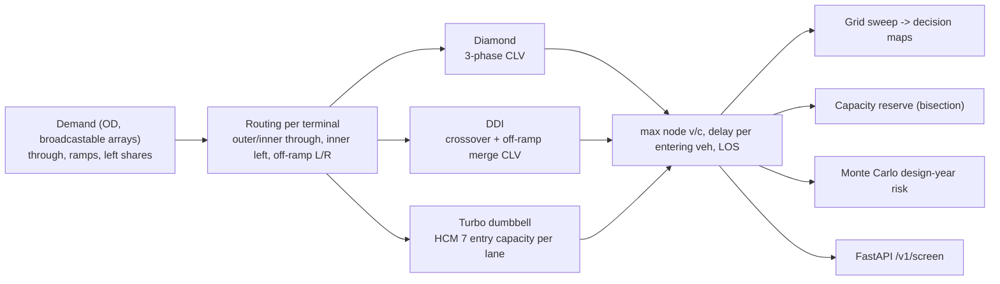
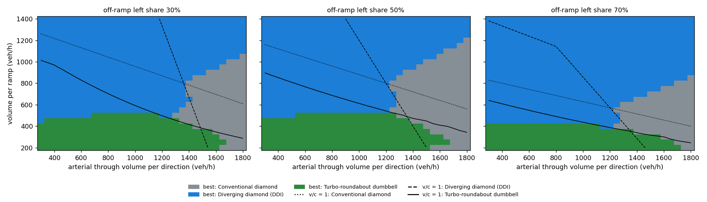

# interchange-geometry-benchmark

**Which interchange form fits which demand?** A vectorised, Cap-X-style screening harness that
routes the same origin-destination demand through a **conventional diamond**, a **diverging diamond
(DDI)** and a **turbo-roundabout dumbbell**, and then:

* sweeps 2,325 demand scenarios;
* maps where each form is best;
* computes capacity reserve;
* estimates design-year failure risk with Monte Carlo.

**Headline:**

* **The answer depends on demand.** At balanced demand (1,000 vph arterial through, 600 vph ramps), the DDI
  cuts delay **38%** vs. the diamond (32.9 vs 53.0 s/veh). With heavy left turns the diamond fails
  (v/c 1.27) and the DDI holds (0.96). With a dominant arterial through movement the **DDI fails**
  (v/c 1.04) and the diamond holds (0.77).
* **It is fast.** The harness runs **1.1 million design evaluations per second**.

---

## 1. Problem formulation

Interchange alternatives analysis (ICE / IJR) starts with a screening step: many forms × many demand
futures, before any Synchro or Vissim model is built. FHWA's Cap-X tool does this with
**critical lane volume (CLV)** analysis for signals and HCM capacity for roundabouts. This repository
reproduces that method in code, which gives three things:

| Bar | Here |
|---|---|
| **Traffic engineering** | Explicit OD routing per geometry, CLV analysis with the correct critical path for each phasing, HCM 7 roundabout entry capacity and delay, HCM LOS, capacity reserve |
| **Analytics** | Full-factorial demand sweep, decision maps with v/c = 1 frontiers, Monte Carlo of base-year error and growth (20,000 draws) |
| **Systems** | Pure NumPy broadcasting with no Python loops over scenarios (1.1 M evaluations/s), vectorised bisection for capacity reserve, FastAPI screening endpoint |

---

## 2. Architecture



---

## 3. Methodology

**Demand and routing.** Arterial east-west over a north-south freeway. Symmetric terminals: through
$A$ per direction, off-ramp $R$ with left share $p$, and on-ramp $R$ with left share $p$. At a terminal:

$$\text{outer through} = A + pR,\qquad \text{inner through} = A + pR,\qquad \text{inner left (to on-ramp)} = pR$$

(outer through includes traffic bound for the far terminal's left-turn on-ramp; inner through includes the
far off-ramp's left turns.)

**Conventional diamond** (phases: inner left + inner through | both throughs | off-ramp; outer right free).
The critical path is

$$CLV = \max\!\Big(\tfrac{L_{in}}{n_L}+\tfrac{T_{out}}{n_T},\ \tfrac{T_{in}}{n_T}\Big)+\max\!\Big(\tfrac{L_{off}}{n_{OL}},\tfrac{R_{off}}{n_{OR}}\Big)$$

**DDI.** Two-phase crossovers; on-ramp lefts are free on the crossed-over side; off-ramp rights are free:

$$CLV_{x}=\tfrac{T_{out}}{n_T}+\tfrac{T_{in}}{n_T},\qquad CLV_{off}=\tfrac{L_{off}}{n_{OL}}+\tfrac{T_{out}}{n_T}$$

Signalised v/c = CLV / 1,600 (Cap-X). Delay uses a Webster cycle $C=(1.5L+5)/(1-Y)$ (50-150 s) and HCM
$d_1+d_2$ for the critical lane groups.

**Turbo-roundabout dumbbell.** Counter-clockwise circulation, legs W (arterial), E (bridge), N (off-ramp
entry), S (on-ramp exit). Circulating flow in front of each entry follows from the routing; for example, the
off-ramp entry faces $T_{in} + L_{in}$. HCM 7 entry capacity:

$$c_{1\text{-lane}}=1380\,e^{-1.02\times10^{-3}v_c},\quad c_{right}=1420\,e^{-0.85\times10^{-3}v_c},\quad c_{left}=1350\,e^{-0.92\times10^{-3}v_c}$$

**Turbo principle:** the right entry lane yields only to the *outer* circulating lane (vehicles leaving at
the next exit), so it uses the single-lane model against that flow. The left lane yields to all circulating
traffic. Delay uses HCM's roundabout equation with the $5\min(x,1)$ geometric term.

**Measures.** The worst node v/c is the screening criterion. Delay is per vehicle *entering the
interchange*, so a vehicle stopped at two signals counts twice. Capacity reserve is the demand multiplier
at which the worst node reaches v/c = 1, found by vectorised bisection.

---

## 4. Results ([`results/screening/RESULTS.md`](results/screening/RESULTS.md))

Lanes: 2 through per direction, 1 inner left, 1 off-ramp left, 1 off-ramp right (same for all forms).

### 4.1 Reference demand cases

| Case | Design | Worst v/c | Delay / entering veh | LOS | Capacity reserve |
|---|---|---|---|---|---|
| **Balanced** (A 1,000; R 600; 50% left) | Diamond | 0.78 | 53.0 s | D | 1.28× |
| | **DDI** | 0.81 | **32.9 s** | **C** | 1.23× |
| | Turbo dumbbell | 0.97 | 47.8 s | E | 1.01× |
| **Heavy left** (A 900; R 900; 70% left) | Diamond | **1.27** | 281 s | F | 0.79× |
| | **DDI** | **0.96** | 58.3 s | E | 1.05× |
| | Turbo dumbbell | 3.40 | 496 s | F | 0.62× |
| **Arterial dominant** (A 1,500; R 400; 40% left) | **Diamond** | **0.77** | 42.4 s | D | 1.30× |
| | DDI | **1.04** | 94.4 s | F | 0.96× |
| | Turbo dumbbell | 0.95 | 41.8 s | E | 1.02× |

### 4.2 Decision map (2,325 scenarios)



| Off-ramp left share | Diamond best | DDI best | Turbo best |
|---|---|---|---|
| 30% | 16% | 64% | 21% |
| 50% | 21% | 57% | 21% |
| 70% | 13% | 71% | 16% |

Scenarios with every node at v/c ≤ 1: diamond 51%, DDI 59%, turbo dumbbell 30%. Beyond all three
frontiers (upper right), no form works with these lane counts. Colour there marks the least-bad option.

### 4.3 Design-year risk (2045, 20,000 Monte Carlo draws)

Base counts ±10% (lognormal), growth N(1.5%, 0.75%) per year, median demand factor 1.35:

| Case | P(v/c > 1): Diamond | DDI | Turbo |
|---|---|---|---|
| Balanced | 61% | 69% | 94% |
| Heavy left | 100% | 92% | 100% |
| Arterial dominant | 58% | 97% | 94% |

**Engineering reading.**

* **The DDI's advantage is left turns, and its weakness is through traffic.** Two-phase crossovers serve
  heavy lefts for free, but both through directions share one crossover cycle. When through flow dominates,
  the crossover becomes the bottleneck (arterial-dominant case: v/c 1.04).
* **"Best today" is not "best in 2045".** At balanced demand the DDI has the lowest delay today, but the
  diamond has the higher capacity reserve (1.28× vs 1.23×) and a lower failure risk in 2045 (61% vs 69%).
  A screening that reports only base-year delay would miss that.
* **The turbo dumbbell is a low-ramp-volume solution.** Off-ramp lefts must yield to all arterial traffic
  circulating past them. It is the best choice where ramps carry below about 400-500 vph, and the worst
  where they are heavy.

### 4.4 Performance

2,325 grid scenarios × 3 designs in 2 ms. **1,000,000 scenarios × 3 designs in 2.7 s (1.1 M evaluations/s)**
on a 4-core laptop, single process.

---

## 5. Layout, reproduce, limitations

```
src/ixbench/core/{demand,capacity}.py   OD routing; CLV, Webster/HCM delay, HCM 7 roundabout capacity/delay
src/ixbench/designs/models.py           diamond, DDI, turbo; capacity reserve
src/ixbench/study.py, report.py, cli.py, api/app.py
tests/ (10 tests: hand-calculated CLVs, HCM formulas, routing identities, monotonicity, API)
```

```bash
python -m venv .venv && .venv/Scripts/activate
pip install -r requirements.txt && pip install --no-deps -e .
pytest && ixbench study && ixbench screen --through 1000 --off-ramp 600
```

**Limitations.** This is planning-level screening, the same tier as Cap-X: no queue spillback between
closely spaced terminals, no weaving, no pedestrian phases, and symmetric demand. Turbo capacity uses
HCM multilane coefficients with lane-separated conflicts, not turbo-specific models such as Fortuijn.
Finalists should go to HCM/Synchro and microsimulation.

## License

MIT
