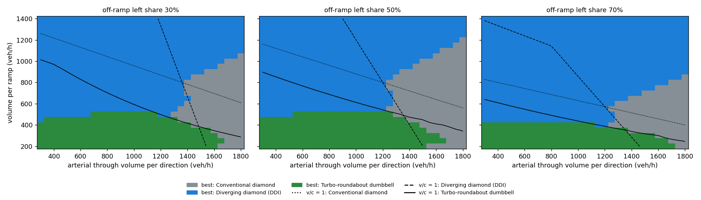

# Interchange screening results

Lanes: {'through': 2, 'inner_left': 1, 'off_left': 1, 'off_right': 1}. 2,325 grid scenarios evaluated in 2 ms.

## Reference demand cases

| Case | Design | Worst node v/c | Delay per entering veh | LOS | Capacity reserve (x demand at v/c = 1) |
|---|---|---|---|---|---|
| balanced | Conventional diamond | 0.78 | 53.0 s | D | 1.28 |
| balanced | Diverging diamond (DDI) | 0.81 | 32.9 s | C | 1.23 |
| balanced | Turbo-roundabout dumbbell | 0.97 | 47.8 s | E | 1.01 |
| heavy_left | Conventional diamond | 1.27 | 281.3 s | F | 0.79 |
| heavy_left | Diverging diamond (DDI) | 0.96 | 58.3 s | E | 1.05 |
| heavy_left | Turbo-roundabout dumbbell | 3.40 | 495.7 s | F | 0.62 |
| arterial_dominant | Conventional diamond | 0.77 | 42.4 s | D | 1.30 |
| arterial_dominant | Diverging diamond (DDI) | 1.04 | 94.4 s | F | 0.96 |
| arterial_dominant | Turbo-roundabout dumbbell | 0.95 | 41.8 s | E | 1.02 |

## Share of the demand grid where each design is best (lowest delay with v/c <= 1)

| Off-ramp left share | Conventional diamond | Diverging diamond (DDI) | Turbo-roundabout dumbbell |
|---|---|---|---|
| 30% | 16% | 64% | 21% |
| 50% | 21% | 57% | 21% |
| 70% | 13% | 71% | 16% |

Share of grid with worst node v/c <= 1: Conventional diamond 51%, Diverging diamond (DDI) 59%, Turbo-roundabout dumbbell 30%

## Monte Carlo: P(v/c > 1) in 2045

Base-year counts +/-10% (lognormal), growth N(1.5%, 0.75%)/yr for 20 years, 20,000 draws.

| Case | Median demand factor | Conventional diamond | Diverging diamond (DDI) | Turbo-roundabout dumbbell |
|---|---|---|---|---|
| balanced | 1.35 | 61% | 69% | 94% |
| heavy_left | 1.35 | 100% | 92% | 100% |
| arterial_dominant | 1.35 | 58% | 97% | 94% |

Benchmark: 1,000,000 scenarios x 3 designs in 2.71 s (1.1 M design evaluations/s).

